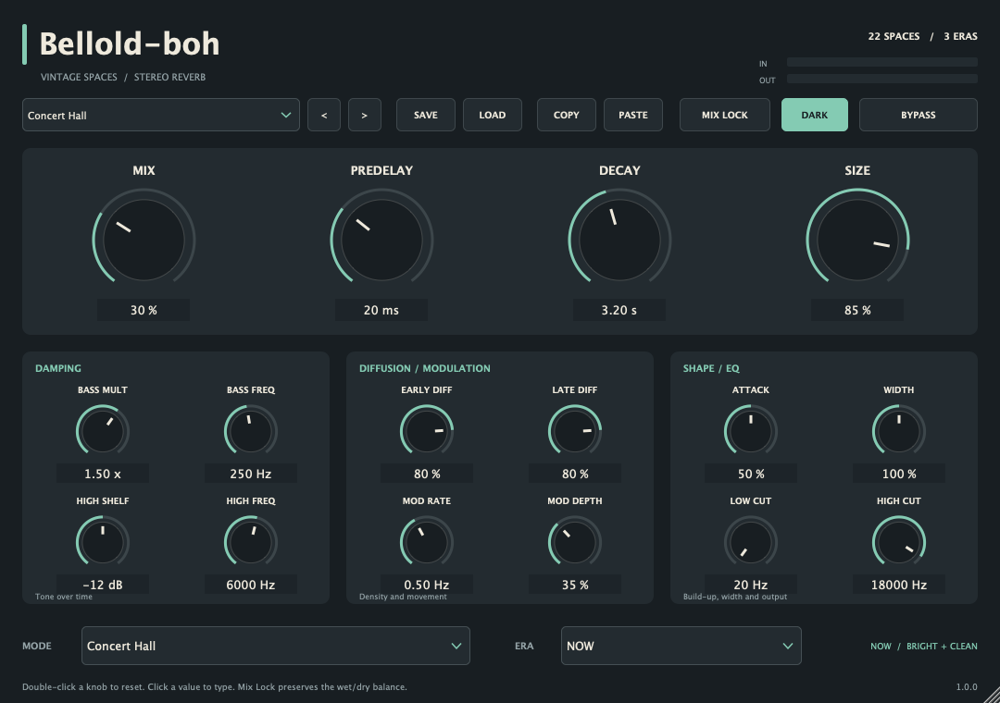

# Bellold-boh

Riverbero VST3 gratuito per macOS Apple Silicon, con 22 modalità, tre epoche
sonore, preset e interfaccia ridimensionabile con tema chiaro e scuro.

## Download

[Scarica l'ultima release](https://github.com/vallaproductionsoriginal-byte/Bellold-boh/releases/latest)
e scegli **Bellold-boh-1.0.0-mac-arm64.zip**.

Il plugin viene distribuito in formato binario. Il repository contiene la
documentazione, le licenze e l'immagine dell'interfaccia.

## Requisiti

- Mac con processore Apple Silicon (arm64).
- macOS 11 o successivo. La build richiede almeno macOS 11; la release è stata
  verificata sul Mac di sviluppo, senza prove su ogni versione di macOS.
- Una DAW con supporto VST3, eseguita nativamente su Apple Silicon.

Questa release contiene soltanto il formato VST3. Logic Pro richiede Audio Unit
e non può caricare questo plugin.

## Installazione

1. Estrai l'archivio ZIP.
2. In Finder scegli **Vai → Vai alla cartella…** e apri
   `~/Library/Audio/Plug-Ins/VST3/`. Crea la cartella se manca.
3. Copia il bundle completo **Bellold-boh.vst3** nella cartella.
4. Riavvia la DAW o esegui una nuova scansione dei plugin VST3.
5. Cerca **Bellold-boh**, produttore **Francesco**, categoria **Reverb**.

Il bundle è firmato ad hoc e non è notarizzato da Apple. macOS può richiedere
un'autorizzazione in **Impostazioni di Sistema → Privacy e Sicurezza** prima
del caricamento.

## Controlli

Mix, predelay, decay, size, attack, damping dei bassi e degli alti, diffusione
early/late, modulazione, low/high cut e larghezza stereo. Le epoche disponibili
sono **1970s**, **1980s** e **NOW**.

Sono inclusi 22 preset. SAVE/LOAD gestiscono i file `.belloldpreset`; COPY/PASTE
trasferiscono i preset tramite appunti. MIX LOCK mantiene il mix quando richiami
un preset. Doppio clic sui controlli per ripristinare il valore iniziale;
clic sul valore per digitarlo. Sono supportati mono e stereo.

## Licenza

I componenti originali di Bellold-boh e la documentazione sono concessi sotto
[licenza MIT](LICENSE). Questa distribuzione non include il codice sorgente
del plugin.

JUCE è utilizzato secondo la licenza commerciale **JUCE Starter**. JUCE e le
altre dipendenze conservano le proprie licenze, riportate integralmente dove
necessario in [THIRD_PARTY_NOTICES.md](THIRD_PARTY_NOTICES.md). La MIT di
Bellold-boh non rilicenzia questi componenti.

## Supporto

Per segnalare problemi, apri una
[issue](https://github.com/vallaproductionsoriginal-byte/Bellold-boh/issues)
indicando versione di macOS, DAW e versione del plugin.
